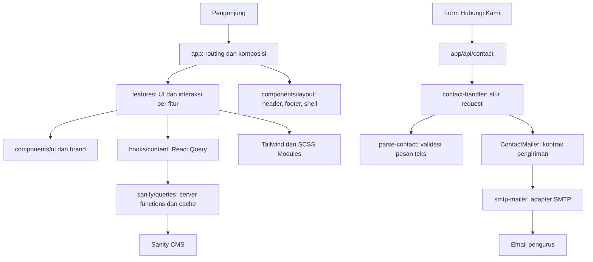

# Website UKM Seni Religi UB

Panduan pengembang untuk periode berikutnya. Stack: Next.js App Router, React,
TypeScript, Sanity, React Query, Tailwind CSS, SCSS Modules, GSAP, dan Nodemailer.
Refactor mempertahankan desain yang sudah disetujui.

## Mulai bekerja

Gunakan Node.js 22.16 atau lebih baru dan npm:

```powershell
npm ci
Copy-Item .env.example .env.local
# Isi konfigurasi Sanity dari pengelola proyek.
npm run dev
```

Website tersedia di `http://localhost:3000`, editor konten di `/studio`.
Produksi: `npm run build`, kemudian `npm start`. Kredensial hanya disimpan di
environment lokal/hosting, bukan Git atau percakapan.

## Lingkungan Sanity dan alur rilis

Proyek Sanity: `yzaa35ug`. Dataset dipisahkan pada 22 Oktober 2026.

| Lingkungan                  | Branch / alamat                                        | `NEXT_PUBLIC_SANITY_DATASET`          |
| --------------------------- | ------------------------------------------------------ | ------------------------------------- |
| Lokal                       | `.env.local`, `http://localhost:3000`                  | `development`                         |
| Vercel Preview khusus `dev` | `website-ukm-sr-git-dev-medkomsrs-projects.vercel.app` | `development` (override branch `dev`) |
| Vercel Production           | Branch `staging`, `website-ukm-sr.vercel.app`          | `production`                          |

**`staging` adalah branch production proyek ini**, bukan lingkungan uji tambahan.
Jangan mempromosikan deployment `dev` langsung ke production. Gunakan alur
branch fitur → PR ke `dev` → uji Preview `dev` → PR ke `staging` → deployment
production otomatis. Setelah merge, pastikan deployment `staging` berstatus Ready
dan menjadi deployment aktif; merge Git saja belum menjamin build berhasil.

Override Vercel dibuat khusus untuk branch `dev`. Preview branch lain masih
mewarisi konfigurasi sebelumnya dan **belum dijamin terpisah dari production**.
Uji CMS di lokal atau Preview `dev` yang baru. Jika membutuhkan preview branch
fitur, tambahkan override dataset `development` untuk branch tersebut dahulu.
Deployment preview lama memiliki konfigurasi saat build dibuat; gunakan alias
branch terbaru, bukan URL deployment lama yang mungkin masih memakai production.

CORS Sanity mengizinkan `http://localhost:3000` dan origin Preview `dev`
`https://website-ukm-sr-git-dev-medkomsrs-projects.vercel.app` dengan credentials
agar login Studio berfungsi. Gunakan alias tersebut untuk Studio preview. Jika
menambah origin baru, daftarkan alamat persisnya; jangan gunakan wildcard.

`development` diisi sekali melalui export/import data dan aset production,
termasuk salinan company profile, tanpa memodifikasi sumber. Tidak ada sinkronisasi
konten otomatis antardataset. Publish, edit, atau hapus di Studio development hanya
berlaku untuk development. Kedua dataset bersifat public sesuai paket gratis;
jangan masukkan informasi rahasia ke dokumen published atau aset uji.

### Pemeriksaan sebelum mengedit konten

1. Periksa `.env.local`: `NEXT_PUBLIC_SANITY_PROJECT_ID=yzaa35ug` dan
   `NEXT_PUBLIC_SANITY_DATASET=development`. `.env.example` sudah menggunakan
   default development. Jangan menyalin environment Production ke lokal.
2. Restart `npm run dev` sesudah mengubah environment. Website dan `/studio`
   menggunakan dataset yang sama. Judul Studio menampilkan `Seni Religi — <dataset>`
   setelah perubahan kode ini dipakai pada deployment terkait.
3. Pada Vercel, periksa **environment dan branch override**, bukan nama branch
   saja. `NEXT_PUBLIC_*` tertanam ketika build; perubahan environment memerlukan
   redeploy **Preview dev**, bukan redeploy Production.
4. Untuk perintah CLI yang menulis, selalu sebutkan target secara eksplisit,
   misalnya `--project-id yzaa35ug --dataset development` jika perintah mendukungnya.
   Periksa header target sebelum meneruskan. Skrip dalam `scripts/` dapat membaca
   `.env.local`; jangan menjalankan seed/cleanup terhadap production untuk uji coba.

### Cache, webhook, dan pemindahan konten

Webhook `Website SR — Production cache` hanya memantau dataset `production` dan
mengirim ke `/api/sanity/revalidate` di domain production. Secret
`SANITY_REVALIDATE_SECRET` hanya tersimpan di environment Production Vercel dan
pengaturan webhook Sanity. Jangan menyalinnya ke Preview atau Git. Draft dan
versions tidak memicu webhook; request tanpa signature ditolak.

Development belum memiliki webhook terpisah. Untuk memeriksa Publish lokal yang
masih tampil lama, restart server development dan muat ulang halaman. Pada Preview
dev, tunggu pembaruan cache atau redeploy Preview dev lalu muat ulang halaman;
React Query di tab yang terbuka juga menyimpan cache. Jangan mengarahkan webhook
development ke endpoint production. Jangan mengubah atau menonaktifkan deployment
protection hanya untuk menyambungkan webhook preview.

Merge kode **tidak memindahkan isi dataset**. Konten final dipublikasikan melalui
Studio production oleh pengelola. Jika perlu migrasi konten, buat rencana terpisah
dengan daftar dokumen, cadangan, dan persetujuan target; jangan mengimpor seluruh
dataset development ke production. Company profile production tetap dikelola
melalui CRUD yang sudah ada dan tidak diubah dalam pemisahan lingkungan ini.

Kedua slot dataset gratis kini digunakan. Gunakan dataset yang sama lintas kabinet;
pisahkan periode lewat dokumen/field sesuai kebutuhan. Salinan aset memakai sumber
daya proyek juga, sehingga hindari menyalin ulang video besar untuk setiap uji.

## Route aktif

Halaman publik: `/`, `/tentang`, `/aktivitas`, `/prestasi`, dan `/kontak`.
Detail publik: `/aktivitas/[id]`, `/tentang/[dept]`, dan
`/tentang/bidang/[bidang]`. `/studio/[[...tool]]` adalah editor CMS;
`/api/contact` melayani formulir kontak.

Route lama `/galeri`, `/katalog`, dan `/prestasi/contoh` sudah dihapus dan
mengembalikan 404. Komponen, hook, serta query khususnya juga telah dihapus.
Skema dan dokumen lama di Sanity dipertahankan agar arsip konten tetap bisa
diakses pengelola; dokumentasi foto pada detail aktivitas dan bidang tetap aktif.

## System design



`app` merangkai fitur dan menetapkan route/metadata. Komponen fitur merender UI;
hooks mengelola state, animasi, atau pengambilan data. Akses CMS dan email
ditempatkan di lapisan layanan. URL publik tetap sama.

## Peta folder

| Folder                   | Tanggung jawab                                                 |
| ------------------------ | -------------------------------------------------------------- |
| `app/`                   | Route, metadata, layout akar, loading/error boundary, endpoint |
| `features/home/`         | Beranda, berita, bidang, prestasi, video, hooks animasi        |
| `features/about/`        | Profil organisasi dan kabinet                                  |
| `features/departments/`  | Detail departemen dan galeri                                   |
| `features/art-fields/`   | Detail bidang seni dan dokumentasi                             |
| `features/activities/`   | Daftar, pratinjau, dan detail berita/acara                     |
| `features/achievements/` | Medali, arsip, filter, dialog prestasi                         |
| `features/contact/`      | Form, FAQ, konfigurasi bersama, layanan email server           |
| `components/layout/`     | Header, footer, skip link, shell publik                        |
| `components/brand/`      | Simbol bidang dan signature partikel bersama                   |
| `components/ui/`         | Primitive UI Radix/shadcn                                      |
| `hooks/content/`         | Hooks React Query untuk CMS                                    |
| `lib/constants/`         | Referensi dan fallback yang masih digunakan                    |
| `lib/query/`             | Factory QueryClient dan kebijakan cache                        |
| `providers/`             | Penyambungan provider di layout                                |
| `sanity/`                | Client, schema, types, query, struktur Studio                  |
| `styles/`                | Token brand dan styling bersama                                |
| `tests/`                 | Kontrak backend, batas arsitektur, acuan styling               |
| `public/`                | Aset statis; dapat dirujuk lewat URL/data CMS                  |

Folder fitur menggunakan bahasa Inggris; route publik tetap bahasa Indonesia.
Komponen memakai PascalCase, file kebab-case, dan hook diawali `use`.
Komponen dan stylesheet lokal diletakkan berdekatan.

## Batas dependensi dan SOLID

- **Single responsibility:** form merender UI, `use-contact-form` mengelola
  state/pengiriman, `parse-contact` memvalidasi, `smtp-mailer` mengirim email.
  Beranda dipecah berdasarkan bagiannya.
- **Open/closed:** provider email baru mengimplementasikan `ContactMailer`
  dan dipasang di route, tanpa mengubah UI.
- **Liskov substitution:** `send(message, id)` selalu mengembalikan
  `Promise<boolean>`. `true` berarti penerima diterima layanan pengiriman,
  bukan jaminan email sudah masuk inbox; adapter menangani kegagalannya.
- **Interface segregation:** handler hanya membutuhkan operasi `send`, bukan
  seluruh API Nodemailer. Topik dan batas pesan memakai konfigurasi bersama.
- **Dependency inversion:** `createContactHandler(getMailer)` menerima adapter
  dari route. Tes menyuntikkan transport palsu tanpa pengiriman email nyata.

`components` dan `lib` tidak boleh mengimpor `features` atau `app`. Fitur tidak
boleh mengimpor route. UI/hooks browser tidak boleh mengimpor folder `server`.
Gunakan API publik Next.js, bukan `next/dist/...`. Tes arsitektur menegakkan
batas ini. Beranda menggunakan pratinjau milik fitur aktivitas agar dialog berita
tidak diduplikasi.

Satukan kode ketika tanggung jawab dan perilakunya sama. Hindari abstraksi
serbaguna dengan banyak flag hanya untuk menyatukan markup yang sekilas mirip.

## Styling dan animasi

- `app/globals.css`: entry Tailwind v4, theme utility, reset dasar.
- `styles/brand-theme.scss`: token brand, tone section, gelombang.
- `*.module.scss`: layout, pseudo-element, keyframe, dan breakpoint lokal.
- `styles/experience.module.scss`: namespace class bersama. Partial foundation,
  responsive, composition, palette, navigation, dan layout dipisahkan di
  `styles/experience/`. Urutan `@include` mempertahankan cascade desain.
- Gunakan Tailwind untuk utility sederhana dan SCSS Module untuk visual kompleks.
  Inline style tetap digunakan untuk nilai dinamis: koordinat, rasio foto,
  dan custom property tiap kartu.
- Pertahankan wrapper DOM, selector `data-*`, durasi, easing, pin, dan breakpoint
  saat refactor. GSAP menggunakan context/cleanup serta reduced motion.
- Jangan mengandalkan hash class CSS Module. Gunakan import module atau `data-*`.

Tes membandingkan hasil kompilasi 17 stylesheet dengan desain sebelum refactor,
termasuk urutan aturan yang dipertahankan. Stylesheet shell hanya menyisakan
aturan skip-link yang masih digunakan; acuannya diambil dari versi sebelum refactor. Pemeriksaan browser tetap diperlukan untuk data CMS,
font, interaksi, dan animasi. Jangan memperbarui acuan
`tests/fixtures/approved-styles.json` hanya agar tes hijau. Perubahan visual
harus disengaja, ditinjau, dan disetujui terlebih dahulu.

## Data dan cache CMS

Schema menentukan formulir editor, `sanity/types.ts` menentukan kontrak data,
dan `sanity/queries` menentukan projection yang diambil. Fungsi query server
menggunakan `use cache`, `cacheLife`, dan `cacheTag`. Hooks konten menggunakan
stale time bersama. QueryClient dibuat per instance provider agar cache tidak
dibagi antar request server; tidak ada singleton di level module.

Saat menambah field: ubah schema, type, projection, lalu komponen pengguna.
Jangan mengubah ID dokumen, nama `_type`, atau dataset untuk merapikan kode.
Schema yang tidak tampil di website tetap dapat digunakan pengurus di Studio.

## Form Hubungi Kami

`POST /api/contact` mengirim pesan teks ke **senireligi@ub.ac.id**.
Penerima ditetapkan server; `Reply-To` adalah email pengunjung. Semua berkas,
termasuk berkas pada field selain `attachments`, ditolak. Field `attachments`
lama juga ditolak meski kosong. Batas seluruh body multipart adalah 32 KiB;
batas isi pesan 4.000 karakter. Validasi field dibagi antara browser dan server.
Kesalahan tampil di dekat kolom dan fokus diarahkan ke isian pertama yang salah.

Minta konfigurasi pengirim yang diizinkan kepada tim TI kampus. Isi
`CONTACT_SMTP_HOST`, `CONTACT_SMTP_PORT`, `CONTACT_SMTP_USER`,
`CONTACT_SMTP_PASSWORD`, dan `CONTACT_FROM` di environment server. Port 587
menggunakan STARTTLS; port 465 memakai TLS sejak awal. Adapter mendukung
username/password; sesuaikan jika kampus mewajibkan OAuth atau relay internal.
Jangan mematikan validasi sertifikat.

Tanpa konfigurasi, endpoint mengembalikan 503 dan form mempertahankan isian.
Dialog terima kasih hanya muncul setelah pengiriman diterima. Tidak ada `.eml`
atau sukses palsu. Lakukan uji nyata yang disetujui setelah konfigurasi tersedia.

Validasi field/origin/ukuran, honeypot, rate limit, dan deduplikasi request tersedia.
Rate limit dan deduplikasi memakai Redis bersama melalui `CONTACT_REDIS_REST_URL`
dan `CONTACT_REDIS_REST_TOKEN`; endpoint menolak pengiriman jika storage tidak
tersedia. Uji lokal menggunakan adapter memori dan SMTP tiruan. Set
`CONTACT_ENABLED=true` hanya setelah layanan produksi diverifikasi. Proxy hosting
harus menghapus `X-Forwarded-For` kiriman pengguna dan menyediakan IP tepercaya.
SMTP tidak menjamin exactly-once ketika koneksi putus; hasil tidak pasti tidak
dikirim ulang otomatis.

## Workflow pengembangan dan pemeriksaan

1. Temukan route di `app`, ikuti import ke folder fiturnya.
2. Pisahkan logika murni ke `lib` lokal fitur, state ke `hooks`, UI ke `components`.
3. Gunakan `SiteLayout` untuk halaman publik. Pertahankan wrapper dan atribut
   tone/wave karena beberapa selector bergantung pada posisi section.
4. Tambahkan tes sukses/gagal untuk aturan backend; jangan kirim email nyata
   dari tes otomatis.
5. Jalankan pemeriksaan dan bandingkan browser desktop/mobile.

```powershell
npm run format        # format source, bukan aset atau backup CMS
npm run check         # lint, TypeScript, tests, pemeriksaan format
npm run build         # verifikasi build produksi
```

Formatter tidak mengurutkan utility Tailwind atau mengganti nilai desain.
ESLint dijalankan tanpa warning yang dibiarkan. Tes menggunakan Node test runner
dan `tsx`; tes email tidak memerlukan kredensial layanan nyata.

Periksa `/`, `/tentang`, `/aktivitas`, `/prestasi`, dan `/kontak` pada desktop
1440×900 serta mobile 430×932. Buka satu
detail aktivitas, bidang, dan departemen. Uji menu, pencarian/filter, carousel,
dialog, Escape, fokus keyboard, serta form kontak. Tunggu data dan font selesai
sebelum membandingkan. Animasi dan partikel dapat menghasilkan frame berbeda.

## Serah terima periode berikutnya

Serahkan akses repository, hosting, domain/DNS, Sanity project/dataset, pengelola
SMTP, dan lokasi environment melalui saluran resmi. Catat penanggung jawab DNS
dan kredensial, hasil pemeriksaan, serta bukti tampilan perubahan terakhir.
Backup CMS di `tmp` bukan source code dan tidak diperlukan untuk build.

Komponen eksperimen lama yang tidak terhubung ke route aktif telah dihapus;
versi sebelumnya tetap tersedia di riwayat Git. Aset publik dan dokumen CMS
tidak dihapus dalam refactor.

### Video company profile

`CompanyReel` memuat preview tanpa suara saat frame terlihat. Preview berhenti saat keluar dari layar, tab tidak aktif, atau player layar penuh dibuka; preferensi reduced motion menggunakan poster statis. Sumber tetap berasal dari `companyVideoUrl` di Sanity (YouTube HTTPS, MP4, atau WebM). Tidak ada video pihak lain yang disalin.

`CompanyVideo` menyatukan kontrol pemutaran, waktu, seek, dan suara untuk YouTube IFrame API maupun HTML video. SDK YouTube dimuat sekali melalui `features/home/lib/youtube-player.ts`. `CompanyVideoDialog` menangani animasi GSAP dari frame ke layar penuh, Escape, penguncian scroll, serta pengembalian fokus. Bila layanan video gagal, player menampilkan tautan ke sumber aslinya.

## Status penguatan keamanan � 22 Oktober 2026

- Respons memakai `X-Frame-Options: DENY`, `nosniff`, kebijakan referrer dan
  pembatasan kamera/mikrofon/lokasi. `X-Powered-By` dinonaktifkan.
- CSP aktif hanya menegakkan `frame-ancestors`, `object-src`, dan `base-uri`.
  Daftar sumber skrip/style/media masih **Report-Only**; bukan mitigasi XSS ketat.
  Inline script/style masih diizinkan karena rendering Next dan animasi.
  Pelanggaran dipantau lewat konsol browser; belum ada endpoint pengumpulan laporan.
  Verifikasi host media, Studio, autentikasi, dan fitur editor di staging sebelum
  menegakkan daftar sumber. Nonce dinamis perlu kajian terhadap Cache Components.
- HSTS belum diaktifkan sampai HTTPS, subdomain, dan konfigurasi hosting diperiksa.
- Konten CMS divalidasi saat dibaca. Slug/judul/identitas tidak valid dikeluarkan;
  tanggal dan field opsional rusak memakai fallback. Daftar bersarang dibatasi.
  Indeks identitas kecil di-cache per jenis konten sebelum count/slice arsip,
  sehingga data yang ditolak tidak membuat total/paginasi menyesatkan. Full content
  tetap diambil per halaman. Webhook invalidasi harus bekerja di produksi.
- `file-type` dan CLI `shadcn` dihapus. Utility CSS accordion yang masih dipakai
  disimpan lokal dengan lisensi MIT. `npm ls braces sprintf-js --all` masih
  menemukan `braces@3.0.3` melalui lint/Sanity CLI dan `sprintf-js@1.0.3` melalui
  Sanity CLI. Advisori [braces](https://github.com/advisories/GHSA-vfj7-8cjw-p6xm)
  dan [sprintf-js](https://github.com/advisories/GHSA-hp3w-g68c-fv3c) belum
  mencantumkan versi patched pada tanggal pemeriksaan. Tidak ada jalur eksploitasi
  publik yang dibuktikan dalam audit ini; jangan memproses pola/format tak tepercaya
  lewat tooling tersebut. Audit penuh perlu diulang: registry npm mengalami timeout
  dan connection reset pada dua percobaan terakhir. Jangan memakai `audit fix --force`
  atau downgrade mayor tanpa uji kompatibilitas Studio.

Verifikasi produksi yang masih diperlukan: header di CDN/hosting dan halaman
error; HTTPS/HSTS; login/role/CORS Sanity; invalidasi cache; Redis lintas instance
serta header IP proxy; pengiriman SMTP nyata yang disetujui; kompatibilitas CSP
untuk YouTube dan editor; Safari/iOS dan Android fisik. Pengelola juga perlu
menetapkan masa penyimpanan serta penghapusan data untuk dokumen privasi resmi.
